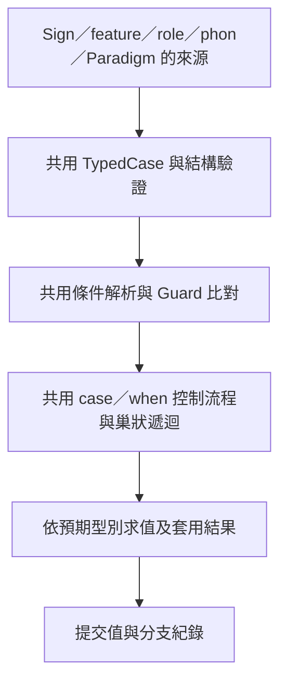

# case 共用求值與 Paradigm 分類選擇提案

狀態：**部分採納**。日期：2026-10-21。
共用執行流程與取消命中後回退已依使用者授權實作，契約見 [I34](../implementation/case-evaluation-unification.md)。
**base 政策維持原樣**；Paradigm 分類 selector、放寬其 base 要求及其餘擴充仍是未採納提案。
後續預設行為的建議集中於[統一 base 控制提案](base-branch-control-proposal.md)。
以下缺口描述是實作前的問題背景，不代表今日驗證狀態。

## 1. 目的與範圍

讓 `.lang` 中相同的 case 在直接推導、Sign application、stored filler、derived-token filler、模板套用與 Paradigm 中，遵守同一套條件和分支規則。

目前已有共用 `TypedCase`、parser 和主要 Guard evaluator，但 feature 與 phon 仍有多套求值器。
2026-10-21 檢查報告（2026-10-21 本機審核紀錄）保存三個可重現缺口：filler feature case 吞掉必填缺值、拒絕巢狀 feature case、拒絕巢狀 phon case。
另有 guard／Equals 與 bundle 遇到結果約束失敗時的回退差異。

本次涵蓋 Sign／維度 context、feature、role、phon、Paradigm 的 case，以及已支援 context 中的 when。
`.chg` function 的交易與來源修改仍依 P69；不因同名就直接換成 `.lang` 的 Sign 求值器，也不在本提案順帶修改其語法。

沿用檢查報告中的引擎模型：一次共時推導是確定性的；Stored Sign 與 token 是不同表示，來源身分、實例身分與 occurrence 身分仍分開。
本提案不引入新的歷史時間、抽樣或人口模型。

## 2. 核心設計：共用控制流程，依結果型別套用



| 共用部分 | 唯一職責 |
|---|---|
| 條件解析與驗證 | guard、bundle、Equals 轉成同一 Guard 模型；檢查名稱、欄位、類別、值域與可見性 |
| 條件求值 | 回傳 Matched／Unmatched／Error；共用 P75 缺值、短路與分類繼承規則 |
| 分支控制 | first-match、when 的 frozen matching、base／else、巢狀 case、失敗與提交順序 |
| 結果求值 | 依預期型別檢查 enum、role、Sign application、fragment 或 phon；不自行尋找下一個分支 |
| 讀取環境 | 將 Stored Sign、token、filler 的現有資料提供給同一讀值器；不重新定義缺值或分類規則 |
| 紀錄 | 從同一分支事件轉成既有直接推導與 occurrence trace，補上各自的來源資訊 |

結果型別仍有差異：

| 位置 | 結果處理 |
|---|---|
| Sign／syn／sem／prag context | 沿用現有 Sign application 或 fragment merge，依 context 限制內容 |
| feature | 回傳並驗證 feature 值；保留既有值集合，不能靠拼接字串重新猜值域 |
| semantic role | 綁定語意節點，檢查分類、optional 與飽和狀態 |
| phon realization | 展開模板、求投影、執行分支音韻規則，維持純 phon 輸入邊界 |
| Paradigm | 呼叫所選成員，轉送共同剩餘參數，保留成員 SignId 與 Paradigm 選擇紀錄 |

「Stored／token」與「feature／phon」是兩個獨立維度。表示方式不應決定能否使用巢狀 case，結果型別也不應決定如何讀取缺席的同一個 feature。

## 3. 建議的統一語意

### 3.1 條件

保留現有三種寫法，使用相同的條件求值器：

```lang
case:
    $slot.head == [N]:
        ...

case [syn.number]:
    [singular]:
        ...

case $self.syn.number:
    == singular:
        ...
```

上面的省略號僅為語法結構說明。分類判斷沿用 `belongs` 閉包、型別實參與詞彙作用域；不新增一個 `class` 值或另一套分類表。

- bundle 的每一個非 `_` 欄位轉成普通條件，保持來源順序與短路。
- 讀到已宣告的必填 feature 而缺值時 Error；optional 缺值不匹配；其他讀取邊界仍依 P75。
- `_` 不讀取該欄。不能先把所有欄位取出，再假裝仍有短路。
- 未決定的多值不等於其中一個單值；條件比對不自行選一個值。
- 未知類別、非法路徑、錯誤型別不能當成 Unmatched。

### 3.2 case：建議採命中後不回退

建議採納的唯一流程：

```text
依序判斷條件
  Unmatched → 下一支
  Error     → 中止
  Matched   → 求值該支結果
                成功 → 提交並返回
                失敗 → 中止
```

巢狀 case 的失敗同樣往外傳遞，不由外層改試下一支。
case 用於按條件選擇，不以「先試著建構一個不合法結果」取代條件判斷。

**此項已依使用者授權納入 I34**：移除 Sign guard／Equals 對部分 constraint failure 的隱性回退；role case 選到未填 slot 時也不再自行嘗試下一支。
role 是否能保留 residual 或合法缺席，由同一 role 結果處理器依既有 partial／optional／飽和規則決定；不能把這些狀態重新翻成另一支 Matched。

原 `runtime_sealing::hard_occurrence_constraint_blocks_only_the_specific_case_branch` 已改為 `matched_case_constraint_failure_is_fatal_instead_of_trying_base`，鎖定錯誤立即傳出的契約。
既有依靠回退的來源要把選擇條件寫清楚；需要搜尋可用構式的用途，另走現有 candidate search 邊界，不為此提案新增猜測式 case。

### 3.3 base 與未匹配

控制流程只判斷是否選中，沒有選中時由預期結果型別提供明確的基底政策。
同一結果型別在所有入口必須相同：

| 預期結果 | 沒有選中分支時 |
|---|---|
| Sign／維度 context | 保留進入 case 時的值 |
| feature | 保留既有合法值；沒有可回傳值時報 `CASE_DEFAULT_MISSING` |
| role | 保留既有 binding；optional／partial 依既有規則，飽和且缺必要 role 時報錯 |
| phon | 使用既有深層模板 |
| Paradigm | 沒有隱含成員，報「沒有匹配成員」 |

一般 case 的空白 `base:` 繼續表示上述既有基底。Paradigm 的 `base` 如有宣告，仍必須明確回傳成員 application。

**尚未採納：建議另外允許 Paradigm 省略 base**，以支援只接受 N／V 的明確分類選擇；沒有匹配就報錯。現行 parser 仍要求最後、非空 base；後續方案見[統一 base 控制提案](base-branch-control-proposal.md)。
這是放寬語法並增加明確失敗情境，不是用錯誤來選擇任意預設成員。

### 3.4 when 與交易邊界

when 保留原有語意：同一份合併前快照判斷所有條件，收集 Matched fragment，最後依來源順序合併。
前一支的結果不能改變同一個 when 後一支的條件；`else` 只在所有普通分支均未匹配時生效。
不擴充目前禁止 when 的 feature、role、phon 或 Paradigm 位置。

值、規則副作用紀錄與成功分支紀錄都在結果有效後提交。
失敗時回傳錯誤位置與必要診斷；不能留下看似已提交的半成品或成功 trace。
這個交易邊界適用於目前的 expression，不回溯撤銷在它之前已完成的獨立推導步驟。

## 4. 編譯與執行的共用邊界

### 4.1 保留來源表示

沿用 `TypedCase`、`CaseCondition`、`Expression`、來源位置及 NodeId；本提案不需要另一套 ParadigmCase AST。
共用條件 lowering 可以產生可重算的 Guard 資料，但不改寫原始來源節點，也不因此重配歷史身分。

`parse_typed_case` 負責語法結構。共用 validator 檢查分支順序、base／else、欄數、條件引用、巢狀結果型別及允許的 context。
parser 可做立即語法診斷；供程式化 AST 使用的同一結構檢查仍須由編譯入口呼叫，避免只修其中一邊。
Paradigm 的「成員必須是 Sign、共同剩餘參數一致」屬實體約束，保留專用驗證。

### 4.2 共用 executor 的接口形狀

以下為內部設計示意，不是新增的公開 API：

```text
evaluate_case(case, read_context, typed_result_handler)
    → typed value + staged branch events，或 typed error

read_context
    → 沿用 Guard evaluator 的 self／slot／feature／分類讀取

typed_result_handler
    → 求值非 case 的結果、提供該型別基底、驗證並套用
```

`Expression::Case` 必須由共用 executor 遞迴處理，handler 不得另寫 branch loop。
when 的匹配和合併也由共用控制層安排，沿用現有 fragment merger。
型別與基底政策以封閉的結果種類決定；呼叫端不能傳入一堆布林旗標，讓 filler 又產生一種不同語言。

優先擴充既有 `synchronic/case.rs` 的條件實作，新增必要的 crate 內部共用 evaluator；既有公用入口可保留為薄轉接。
共用層不依賴 `CompiledSystem` facade；若需要應用 Sign 或執行 phon，傳入現有服務的窄介面或下移共用執行部分，避免 construction 回呼 system 再重入同一 filler 管線。
不增加新 crate 或公開 extension framework。

### 4.3 合併與移除的實作

| 現有實作 | 目標 |
|---|---|
| `synchronic::run_sign_feature_expressions` | 移除內建條件判斷與只接受直接 enum 的分支處理 |
| `system::evaluate_feature_case`／`construction::evaluate_token_feature_case` | 同一 feature 結果實作，Stored／token 只在讀寫資料處轉接 |
| `system::evaluate_phon_case`／`construction::realize_stored_filler` 的 case 迴圈 | 同一 phon 結果能力，直接與 filler 都可處理合法巢狀 case／投影 |
| `system::evaluate_sign_case`／token role case | 將分支控制交給共用層，保留 Sign／role 結果處理 |
| `apply_paradigm_application` | 共用選擇，只保留參數轉送、成員身分與專用 trace 資訊 |
| `CaseRecord`／`OccurrenceCaseRecord` | 由相同事件資料轉接；差異只在 target、occurrence 路徑與 Paradigm 資訊 |

完成後不得讓同名舊函式保留另一份完整 evaluator；需要舊函式名稱的呼叫端只轉送至共用實作。
也不能用「已求值」標記把未跑的步驟略過，來消除表面上的重複。

### 4.4 保持推導階段與作用域

- Syn → Sem → Prag、Sign expression、phon realization 與音變的既有階段順序保留。
- deferred autofill 仍在明示 filler 及 consumer probe 之後選擇；同批選擇共享快照，成功後提交，正式管線按既有契約執行。
- occurrence 約束仍從不可變 deep baseline 重建，不能以已完成的表層重新跑規則。
- Stored／token 共用行為不代表將二者抹成相同身分；來源 SignId、實例實參、slot path、partial parameters 必須保留。
- Sign 直接內容、trait 套用與巢狀模板捕捉參數遵守 I32／I33；公開呼叫不取得私有成員權限。

## 5. Paradigm 依 head 分類選擇

以下是**採納並完成擴充後**的語法，現在的引擎仍拒絕這種 Paradigm selector。
沿用已有的 `XP<T>`、N、V、NP、VP，以及公開的 `bar-comp`；不需要新增 kind feature：

```lang
export paradigm Phrase:
    case:
        $slot.head == [N]:
            NP(head: NP.bar-comp(head: {$slot.head}))
        $slot.head == [V]:
            VP(head: VP.bar-comp(head: {$slot.head}))

sign AutoPhrase:
    syn:
        slots:
            head [*]
            phrase [*]
        map phrase autofill Phrase()
    phon:
        /{$slot.phrase}/
```

`Phrase()` 讀呼叫者的 head：N 選 NP、V 選 VP；同時屬於兩類時仍按來源順序選第一支，兩者都不屬於則報錯。
真正的 NP／VP 是填入 `phrase` 的成員，AutoPhrase 仍是 consumer；不能把外層 consumer 的身分冒充成所選成員。

分支先綁定 NP／VP 的 head，所以兩者留下相同的 optional spec 介面。
其中 `NP.bar-comp`／`VP.bar-comp` 仍是 `XP<N>.bar-comp`／`XP<V>.bar-comp` 的既有別名，私有 Bar 和傳到底層的型別約束完整保留。
這裡選的是既有 Sign；不增加 `XP(head: ...)` 的泛型自動推導，也不把 `$slot.head` 變成 Paradigm 自己宣告的新參數。

編譯與呼叫須同時補齊：

1. guard、bundle、Equals 共用條件語法。純分類 guard 不需要成員宣告額外 feature；讀取 `$self` 的 typed feature 時，使用同一套欄位與共同 domain 檢查，不因改成 guard 拼法就跳過驗證。
2. 類別名稱依宣告處的詞彙／套件／型別實參作用域綁定；不能在執行時依消費者同名文字重新找類別。
3. `$slot` 值由 caller 提供。編譯器收集 context 讀取需求，在已知 consumer 的呼叫點檢查 slot/schema；這是讀取需求，不是新增呼叫參數。
4. 未知動態 caller 仍由共用讀值器檢查；只有 feature bundle 的 `evaluate_paradigm(name, context)` 不會憑空有 head。需要 slot 的案例使用既有 `evaluate_application(current, ...)` 或 consumer；缺上下文時在實際讀取處明確報錯，不能誤走 base。
5. Paradigm 的直接成員仍是 Sign application，保留共同剩餘介面、成員身分及循環檢查。巢狀結果能力由其允許的結果型別決定，本次不額外開放以另一個 Paradigm 當成員或任意巢狀 selector。

## 6. 相容性與遷移

| 類別 | 處理方式 |
|---|---|
| 已有合法 bundle／guard／Equals 語法 | 保留；純重構不改 canonical 拼法 |
| P75 缺值、filler 巢狀 case | 修正為既有契約要求的同等行為，新增反例回歸 |
| guard／Equals constraint fallback、role 缺 slot 回退 | 明列為本提案建議變更，採納後修改契約、來源與對應測試 |
| Paradigm guard／Equals、可省略 base | 明列新增能力；通過新驗收後才更新教學與狀態 |
| 來源 NodeId、SignId、型別實例 | 不為重構分配新來源身分；新增分類引用須通過既有 binder／rename／replay |
| 編譯快取 | 行為變更時提升 `COMPILER_SEMANTICS_VERSION`，不沿用舊求值結果 |
| sidecar／reference semantics | AST 不變不代表必然不用調整 binder；以新分類引用的 round-trip 證據決定，不能預先宣稱格式無影響 |
| 舊歷史資料 | 來源與歷史紀錄不改寫；新版重新推導採新版契約，精確重現舊錯誤行為須保留當時引擎版本 |

不長期保留「直接版／filler 版」兩套 evaluator 作相容模式。歷史 trace 的 MoreSpecificBlocked 可以繼續讀取，無須為了新契約刪除舊資料。

## 7. 實作順序與驗收出口

| 步驟 | 產物 | 出口 |
|---|---|---|
| 1. 固定證據與採納契約 | 將 audit 案例納入回歸，對回退政策、新 Paradigm selector、base 作裁定 | 清楚區分既有 bug、新能力與相容性變更 |
| 2. 統一條件與 feature case | 所有入口使用共同 Guard 與同一 feature 結果 evaluator | 必填缺值／optional／短路／巢狀 feature 的直接與 filler 對照通過 |
| 3. 統一分支控制與其他結果 | Sign、role、phon、when 接上共用遞迴／提交／trace | 巢狀 phon、partial、role、when 凍結讀取及失敗無部分提交通過 |
| 4. 接通 Paradigm 分類選擇 | 使用共用 case，補 caller context 驗證與 API 邊界 | noun → NP、verb → VP、無匹配錯誤、重疊分類順序及 Bar 家族隔離通過 |
| 5. 移除重複、完成生命週期 | 刪除舊 executor、更新 cache／契約／教學 | 模板一致性、rename／replay、持久化、CLI 與相關 workspace 測試通過 |

每一步都須是可編譯、可檢查的變更；不得把 failing 測試設為 ignored，或更新快照掩蓋原本的錯誤。
只在有新變更或未解問題時擴大／重跑測試，避免用重複的通過數取代覆蓋。

## 8. 持續防止分歧

新增 case 能力時，使用同一組手工核對的案例測試多種入口；不讓每個 evaluator 只測自己的 happy path。
比較可觀察值與必要錯誤，而不是強求不同 occurrence 的來源身分逐值相同。

| 檢核軸 | 必要證據 |
|---|---|
| 入口 | 直接 Stored／token、stored filler／token filler、partial resume、nested application |
| 來源 | 直接 Sign、trait 套用、帶 N／V 實參的巢狀成員、跨套件可見性 |
| 條件 | guard／bundle／Equals 的等價條件；分類祖先與不匹配；`_`、短路、多值、必填與 optional 缺席 |
| 結果 | feature、role、Sign、context、phon 各有單層與合法巢狀案例；非法結果由共用驗證拒絕 |
| 控制 | 第一支命中、無匹配、空 base、結果失敗中止、when 凍結匹配、錯誤不提交半成品 |
| 觀察 | surface 之外比對 feature、role、類別、selected member SignId、residual parameters、來源與 branch trace |
| 生命週期 | dump／parse、來源 rename／edit、reconstruct／replay、GraphStore 重開、cache 失效與 CLI |

採風險導向與成對組合，無須把所有軸做無意義的全排列。
成功行為以完整 `derive`／`derive_with_context` 驗證；低階 adapter 測試須標出停在哪一階段。
加入能分辨規則執行一次／兩次的案例，保護 occurrence 重建與 autofill probe。

維護約束建議在採納後加入開發指引：

> `.lang` 的 case／when 分支控制與條件語意只能由共用 evaluator 提供。新增結果型別只實作結果處理；新增入口只轉接資料。新增能力須有跨入口及直接 Sign／模板等價測試。

## 9. 建議採納的三項決策

1. **共用一套控制流程與結果實作**：入口只負責提供資料、保存身分與映射診斷。
2. **所有 case 命中後，結果失敗直接報錯**：移除按 guard／bundle 拼法區分的隱性回退。
3. **Paradigm 接受同一套分類 guard，允許省略 base**：未匹配報錯，仍只選既有成員 Sign。

這三項在本文件中均為建議；本次沒有實作語法、改動既有契約或重新宣稱引擎已通過新驗收。

## 依據

- [現行 case／when／fragment 契約](../specifications/case_when與context_fragment_v2.md)
- [P75 缺值與跨入口一致性](../specifications/feature缺席語意與optional標記_v1.0.md)
- [現行 Paradigm 與 SignApplication](../specifications/Paradigm與SignApplication_V3.md)
- [I32 型別傳遞](../implementation/nested-types-and-specialization.md)、[I33 模板一致性](../implementation/trait-template-consistency.md)
- [共時功能待辦及未定事項](../implementation/待辦清冊_P72-P96_v0.1.md)
- [驗證指令與平台邊界](../verification/README.md)
